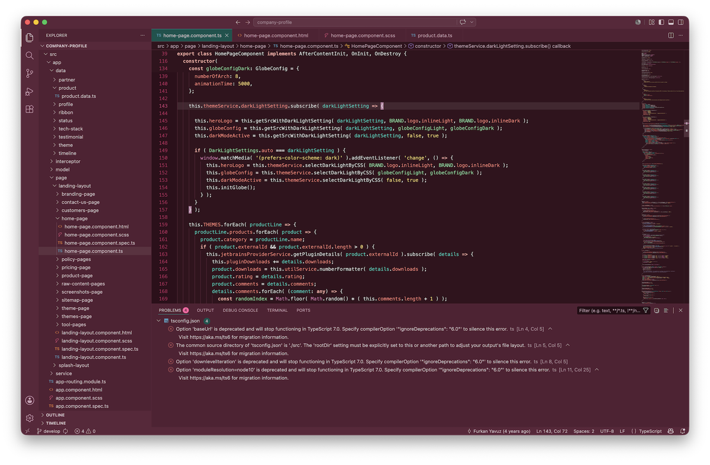
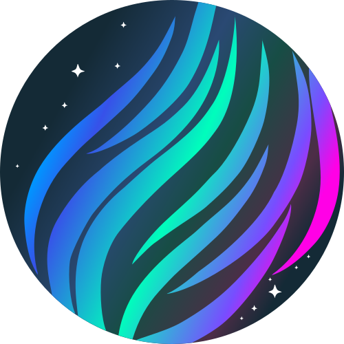
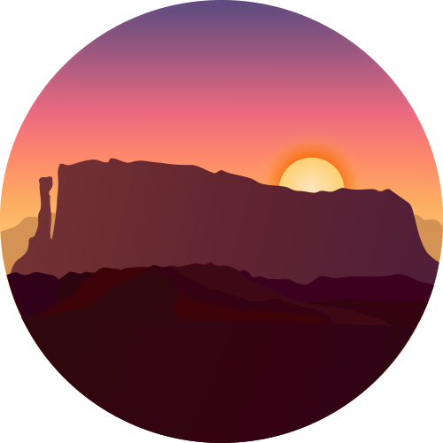

### Features

- Complete workbench theming across the editor, sidebar, activity bar, status bar, panels, tabs and the integrated terminal
- Carefully tuned syntax highlighting with semantic token coloring for readable code
- Purposeful, distinct colors for keywords, strings, numbers, variables, parameters and comments
- Vibrant, city-inspired palette with a rich, cinematic atmosphere
- Actively maintained and regularly refined

Enjoying our theme? Giving us a <b>5-star</b> rating on the Open VSX Registry helps us grow and create more themes!

Have feedback or found an issue? Please report it on our <a href="https://github.com/codigrate/vscode-themes/issues"><b>Issue Tracker</b></a>.

### Color Palette
<table>
   <tr>
      <td></td>
      <td>
         Midnight Vice
      </td>
      <td>
         Editor Background
      </td>
      <td>
         <a href="https://codigrate.com/tools/color/33121D">#33121D</a>
      </td>
   </tr>
   <tr>
      <td></td>
      <td>
         Plum Night
      </td>
      <td>
         Window Background
      </td>
      <td>
         <a href="https://codigrate.com/tools/color/532033">#532033</a>
      </td>
   </tr>
   <tr>
      <td></td>
      <td>
         Miami Pink
      </td>
      <td>
         Accent Color
      </td>
      <td>
         <a href="https://codigrate.com/tools/color/FF5FA2">#FF5FA2</a>
      </td>
   </tr>
   <tr>
      <td></td>
      <td>
         Flamingo
      </td>
      <td>
         Tags
      </td>
      <td>
         <a href="https://codigrate.com/tools/color/FE788C">#FE788C</a>
      </td>
   </tr>
   <tr>
      <td></td>
      <td>
         Sunset Coral
      </td>
      <td>
         Instance Fields
      </td>
      <td>
         <a href="https://codigrate.com/tools/color/FE8078">#FE8078</a>
      </td>
   </tr>
   <tr>
      <td></td>
      <td>
         Coral Haze
      </td>
      <td>
         Keywords
      </td>
      <td>
         <a href="https://codigrate.com/tools/color/F2A4A0">#F2A4A0</a>
      </td>
   </tr>
   <tr>
      <td></td>
      <td>
         Art Deco Blue
      </td>
      <td>
         Static Fields
      </td>
      <td>
         <a href="https://codigrate.com/tools/color/92B5E8">#92B5E8</a>
      </td>
   </tr>
   <tr>
      <td></td>
      <td>
         Electric Aqua
      </td>
      <td>
         Parameters
      </td>
      <td>
         <a href="https://codigrate.com/tools/color/00D1C1">#00D1C1</a>
      </td>
   </tr>
   <tr>
      <td></td>
      <td>
         Palm Green
      </td>
      <td>
         Local Variables
      </td>
      <td>
         <a href="https://codigrate.com/tools/color/82D59F">#82D59F</a>
      </td>
   </tr>
   <tr>
      <td></td>
      <td>
         Golden Sand
      </td>
      <td>
         Strings and Numbers
      </td>
      <td>
         <a href="https://codigrate.com/tools/color/F8D273">#F8D273</a>
      </td>
   </tr>
</table>

### Screenshots

### Codigrate Theme Collection
 
All 25 themes are available in the All In One Themes.
 
 
<table width="100%">

   <tr>
      <td width="72"></td>
      <td width="220"><a href="https://open-vsx.org/extension/codigrate/cod-everest-theme"><b>Everest</b></a> Nature - Light</td>
      <td width="180">
          
         Calm - Icy - Sunrise
      </td>
      <td></td>
   </tr>

   <tr>
      <td width="72"></td>
      <td width="220"><a href="https://open-vsx.org/extension/codigrate/cod-sakura-theme"><b>Sakura</b></a> Nature - Light</td>
      <td width="180">
          
         Pastel - Soft - Elegant
      </td>
      <td></td>
   </tr>

   <tr>
      <td width="72"></td>
      <td width="220"><a href="https://open-vsx.org/extension/codigrate/cod-autumn-theme"><b>Autumn</b></a> Nature - Light</td>
      <td width="180">
          
         Cozy - Warm - Earthy
      </td>
      <td></td>
   </tr>

   <tr>
      <td width="72"></td>
      <td width="220"><a href="https://open-vsx.org/extension/codigrate/cod-aurora-borealis-theme"><b>Aurora Borealis</b></a> Nature - Dark</td>
      <td width="180">
          
         Arctic - Cinematic - Luminous
      </td>
      <td></td>
   </tr>

   <tr>
      <td width="72"></td>
      <td width="220"><a href="https://open-vsx.org/extension/codigrate/cod-sequoia-theme"><b>Sequoia</b></a> Nature - Dark</td>
      <td width="180">
          
         Forest - Earthy - Calm
      </td>
      <td></td>
   </tr>

   <tr>
      <td width="72"></td>
      <td width="220"><a href="https://open-vsx.org/extension/codigrate/cod-roraima-theme"><b>Roraima</b></a> Nature - Dark</td>
      <td width="180">
          
         Sunset - Mystical - Atmospheric
      </td>
      <td></td>
   </tr>

   <tr>
      <td width="72"></td>
      <td width="220"><a href="https://open-vsx.org/extension/codigrate/cod-ocean-theme"><b>Ocean</b></a> Nature - Dark</td>
      <td width="180">
          
         Deep - Tranquil - Immersive
      </td>
      <td></td>
   </tr>

   <tr>
      <td width="72"></td>
      <td width="220"><a href="https://open-vsx.org/extension/codigrate/cod-istanbul-theme"><b>Istanbul</b></a> City - Light</td>
      <td width="180">
          
         Mediterranean - Historic - Airy
      </td>
      <td></td>
   </tr>

   <tr>
      <td width="72"></td>
      <td width="220"><a href="https://open-vsx.org/extension/codigrate/cod-rio-de-janeiro-theme"><b>Rio de Janeiro</b></a> City - Light</td>
      <td width="180">
          
         Tropical - Coastal - Energetic
      </td>
      <td></td>
   </tr>

   <tr>
      <td width="72"></td>
      <td width="220"><a href="https://open-vsx.org/extension/codigrate/cod-tallinn-theme"><b>Tallinn</b></a> City - Light</td>
      <td width="180">
          
         Nordic - Icy - Cool
      </td>
      <td></td>
   </tr>

   <tr>
      <td width="72"></td>
      <td width="220"><a href="https://open-vsx.org/extension/codigrate/cod-miami-theme"><b>Miami</b></a> City - Dark &middot; This Plugin</td>
      <td width="180">
          
         Neon - Tropical - Sunset
      </td>
      <td></td>
   </tr>

   <tr>
      <td width="72"></td>
      <td width="220"><a href="https://open-vsx.org/extension/codigrate/cod-paris-theme"><b>Paris</b></a> City - Dark</td>
      <td width="180">
          
         Romantic - Elegant - Sunset
      </td>
      <td></td>
   </tr>

   <tr>
      <td width="72"></td>
      <td width="220"><a href="https://open-vsx.org/extension/codigrate/cod-tokyo-theme"><b>Tokyo</b></a> City - Dark</td>
      <td width="180">
          
         Neon - Futuristic - Energetic
      </td>
      <td></td>
   </tr>

</table>

<table>
<tr>
	<td width="72"></td>
	<td width="220"><a href="https://codigrate.com"><b>codigrate.com</b></a></td>
</tr>
</table>

